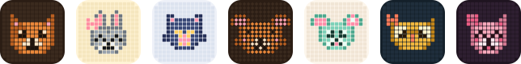
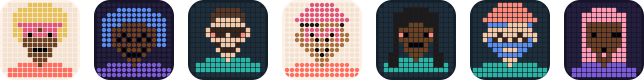

# Seedkin

Seeded pixel avatars, drawn as SVG. Plant a seed (a user id, any string) and the same avatar sprouts every time, on any machine, with nothing stored.


**[Try it at seedkin.dev](https://seedkin.dev)** · [Docs](https://seedkin.dev/docs/) · [npm](https://www.npmjs.com/package/seedkin) · [Changelog](CHANGELOG.md)

- **Same seed, same avatar.** No storage, no network requests, no randomness you have to keep.
- **Five styles.** Robots, animals, people, monsters and elemental spirits, each its own entry point, so an app only ships the styles it uses.
- **Reads at any size.** Below 40px each style draws a simpler 9x9 version of the same avatar, so a 24px avatar still has a face.
- **Small and self-contained.** Zero dependencies, returns an SVG string, works in the browser, Node and edge runtimes. ESM and TypeScript types included.
- **MIT licensed**, art included.

## Install

```sh
npm install seedkin
```

## Use

```ts
import { botling, botlingDataUri } from 'seedkin/botling';

// An SVG string, for inlining.
const svg = botling(user.id);

// A data: URI, for  or CSS url().
const src = botlingDataUri(user.id, { size: 48 });
```

```tsx

```

Every style works the same way: swap `botling` for `snoot`, `noggin`, `beastie` or `sprite`. Seed with an opaque, stable id such as a database id or UUID, not an email address: anyone can render the avatar for a guessed email and compare. [Choosing a seed](https://seedkin.dev/docs/#choosing-a-seed) has more, and there are guides for [React](https://seedkin.dev/docs/react/), [Vue](https://seedkin.dev/docs/vue/), [Svelte](https://seedkin.dev/docs/svelte/), [plain HTML](https://seedkin.dev/docs/html/), [the server](https://seedkin.dev/docs/server/) and [falling back from a profile photo](https://seedkin.dev/docs/fallback/).

## Styles

### Botling


Robots with screens, antennas, visors and grilles. `import { botling } from 'seedkin/botling'` · [Docs](https://seedkin.dev/docs/botling/) · [Playground](https://seedkin.dev/styles/botling/)

### Snoot



Animals: cats, foxes, bears, bunnies, mice, dogs, pandas, owls, frogs and pigs. `import { snoot } from 'seedkin/snoot'` · [Docs](https://seedkin.dev/docs/snoot/) · [Playground](https://seedkin.dev/styles/snoot/)

### Noggin



People in seven skin tones, with twelve hairstyles (afros and locs included), glasses, beards, hats and headscarves. `import { noggin } from 'seedkin/noggin'` · [Docs](https://seedkin.dev/docs/noggin/) · [Playground](https://seedkin.dev/styles/noggin/)

### Beastie


Monsters: blobs, ghosts and boxy, tall or wide bodies with one to three eyes, fangs, horns and wings. `import { beastie } from 'seedkin/beastie'` · [Docs](https://seedkin.dev/docs/beastie/) · [Playground](https://seedkin.dev/styles/beastie/)

### Sprite


Little elemental spirits of fire, water, earth, wind and space: flames, drops, gems, clouds, planets and more, each with a face. `import { sprite } from 'seedkin/sprite'` · [Docs](https://seedkin.dev/docs/sprite/) · [Playground](https://seedkin.dev/styles/sprite/)

Each style salts the seed, so one user's robot, animal and monster don't share colours or features.

## Options

Every style takes the same options. The seed picks the shape and palette unless you pass them; the rest are yours to set.

| Option | Default | What it does |
|---|---|---|
| `size` | `96` | Width and height in pixels. The SVG scales cleanly to any size. |
| `shape` | from the seed | Cell shape: `'square'`, `'circle'`, `'triangle'` or `'diamond'`. Sprite defaults to `'square'`. |
| `palette` | from the seed | An index into the style's `PALETTES`, or a palette object such as one of its `HOLIDAY_PALETTES`. |
| `look` | `'gapped'` | How cells are drawn: `'gapped'`, `'flat'`, `'inked'`, `'soft'`, `'soft-inked'` or `'sticker'`. |
| `frame` | `'square'` | The outline of the background: `'square'`, `'rounded'`, `'squircle'` or `'circle'`. |
| `animate` | `false` | A small CSS animation inside the SVG: hovering, blinking, talking. Holds still for anyone who prefers reduced motion. |
| `detail` | `'auto'` | `'full'` 15x15, `'small'` 9x9, or `'auto'` (small below 40px). |
| `showGrid` | `'auto'` | Draw the empty grid cells (gapped look only, from 40px up). |
| `background` | `true` | Draw the palette's background. |
| `title` | e.g. `'Robot avatar'` | Accessible name. `null` marks the image decorative. |

Noggin adds `skin` and Sprite adds `element`. Bad options throw a `RangeError` rather than drawing nothing. A seed never picks a look, frame or holiday palette, so store the ones a user chooses next to their seed. `randomSeed()` makes a readable seed like `plucky-servo-427` for a "new avatar" button, and `traits`, `grid` and the parts lists are exported for building a picker or drawing to a canvas. The [Botling docs](https://seedkin.dev/docs/botling/) cover each option in full, and [How it works](https://seedkin.dev/docs/how-it-works/) explains how a seed becomes a picture.

## Versioning

The picture is the API. Within a major version, a seed with the same options always draws the same avatar, so you can store a seed and get the same face through every 2.x release. All five styles are Stable. Don't compare or cache avatars by their SVG string across versions: the markup can get smaller while the picture stays put. See [Versioning](https://seedkin.dev/docs/versioning/) and [ADR 0001](docs/adr/0001-the-picture-is-the-api.md).

> **Coming from the `botling` package?** Import from `'seedkin/botling'` instead of `'botling'`. Every seed draws the same robot as `botling` 1.2.0.

## Contributing

Issues and pull requests are welcome. [CONTRIBUTING.md](CONTRIBUTING.md) covers setup, the commands and the one rule (a seed must keep drawing the same avatar), and every decision worth keeping is recorded in [docs/adr/](docs/adr/).

## Support

Seedkin is free and MIT licensed. If it's useful to you, you can [buy me a coffee on Ko-fi](https://ko-fi.com/mtblck) or [sponsor on GitHub](https://github.com/sponsors/mtblck).

## License

[MIT](LICENSE), art included.
